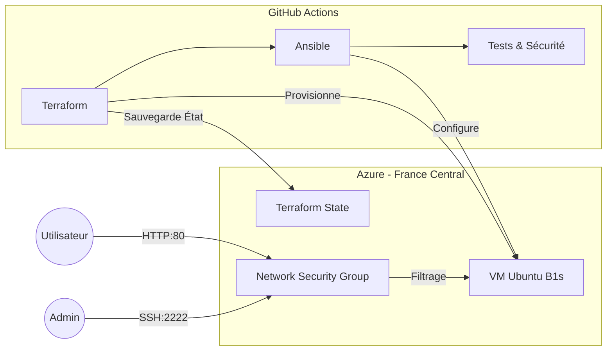

# Architecture de l'Infrastructure

## Vue d'ensemble

Le schéma ci-dessous illustre le flux de déploiement et l'architecture réseau sur Azure.

### Composants Techniques

1. Compute (VM)
OS : Ubuntu 22.04 LTS
Taille : Standard_B1s (1 vCPU, 1 GiB RAM)
Disque : HDD Standard LRS

2. Réseau & Sécurité
IP Publique : Dynamique (attachée à la VM).

NSG (Firewall Azure) :

Allow-HTTP (Port 80) : Ouvert au public.

Allow-SSH-Custom (Port 2222) : Ouvert pour l'administration.

Tout le reste est bloqué par défaut.

!!! warning "Note sur le Port SSH"
    Le port standard 22 est désactivé après la première configuration pour éviter les scans automatisés de bots.

---

### Étape 4 : Le Pipeline CI/CD (`docs/pipeline.md`)

Explique comment la magie opère.

# Pipeline d'Intégration Continue

Le déploiement est orchestré par un workflow **GitHub Actions** intelligent.

## Étapes du Workflow

### 1. Security Scan (Trivy)
Analyse statique du code (IaC) avant même de toucher à l'infrastructure.
* Détecte les mauvaises configurations Terraform.
* Génère un rapport HTML intégré à cette documentation.

### 2. Terraform (Infrastructure)
Applique le code HCL pour créer ou mettre à jour les ressources.
* Gère le `tfstate` dans un Storage Account Azure sécurisé.
* Exporte l'adresse IP publique pour l'étape suivante.

### 3. Ansible (Configuration)
C'est l'étape "Intelligente" du pipeline.

!!! tip "Logique de Détection de Port"
    Le script vérifie automatiquement si la VM est neuve (Port 22) ou déjà sécurisée (Port 2222).
    Cela garantit l'**idempotence** du déploiement.

**Tâches effectuées :**
* Installation d'Apache2.
* Configuration du Firewall UFW.
* Durcissement SSH (Clés uniquement, Root interdit).
* Mise en place de ModSecurity (WAF).

### 4. Documentation
Génération automatique de ce site via **MkDocs** et publication sur GitHub Pages.