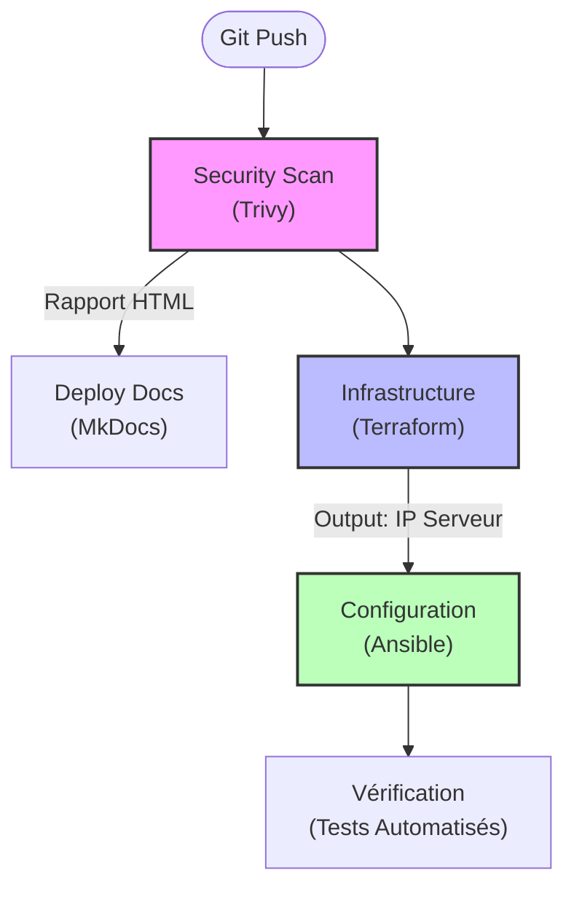

# Pipeline CI/CD Automatisé

Le déploiement de l'infrastructure est entièrement orchestré par un workflow **GitHub Actions**. Ce pipeline incarne l'approche **DevSecOps** en intégrant la sécurité dès les premières étapes (Shift-Left Security).

---

## Vue d'ensemble du Flux

Le schéma ci-dessous illustre l'enchaînement séquentiel des tâches lors d'un `git push` sur la branche `main`.



---

## Détail des Étapes (Jobs)

### 1. Security Scan (Trivy)

**Objectif :** Analyser le code "Infrastructure as Code" (IaC) avant tout déploiement.

Ce job utilise **Aquasecurity Trivy** pour scanner les fichiers Terraform et les Playbooks Ansible. Il cherche :

* Les vulnérabilités connues (CVE).
* Les mauvaises configurations de sécurité (ex: Ports ouverts inutilement, absence de chiffrement).
* Les secrets oubliés dans le code.

!!! tip "Reporting"
    Le résultat du scan est converti en **HTML** et injecté automatiquement dans la page [Sécurité & Audit](https://www.google.com/search?q=./security.md) de cette documentation.

---

### 2. Deploy Documentation (MkDocs)

**Objectif :** Garantir que la documentation est toujours à jour avec le code ("Living Documentation").

* Génère le site statique à partir des fichiers Markdown.
* Intègre le rapport de sécurité généré à l'étape précédente.
* Publie le résultat sur **GitHub Pages**.

---

### 3. Infrastructure (Terraform)

**Objectif :** Provisionner les ressources Azure de manière immuable.

* **Initialisation :** Connexion au Backend Azure (Storage Account) pour récupérer le fichier d'état `terraform.tfstate`.
* **Plan & Apply :** Terraform compare l'état désiré (le code) avec l'état réel (Azure) et applique les changements.
* **Output :** À la fin, Terraform exporte l'adresse **IP Publique** de la VM pour que l'étape suivante puisse s'y connecter.

---

### 4. Configuration (Ansible)

**Objectif :** Configurer le serveur, installer les logiciels et durcir la sécurité.

C'est l'étape la plus complexe, car elle contient une **logique d'intelligence** pour gérer la connexion SSH.

#### La Logique de Détection de Port

Le pipeline doit pouvoir se connecter aussi bien à une **nouvelle VM** (Port 22 par défaut) qu'à une **VM déjà sécurisée** (Port 2222).

!!! abstract "Algorithme de Connexion"
    Le script bash exécute la boucle suivante :
    1.  Tente une connexion sur le port **2222** (Cas : Mise à jour).
    2.  Si échec, tente une connexion sur le port **22** (Cas : Nouvelle VM).
    3.  Une fois le port trouvé, il génère l'inventaire Ansible dynamiquement.

**Actions Ansible :**

1. Installation des paquets (Apache2, Fail2Ban, UFW).
2. Mise en place de la page Web et du CSS.
3. Application des règles de sécurité (WAF, Headers).
4. Changement du port SSH vers 2222 (si ce n'est pas déjà fait).

---

### 5. Tests & Validation

**Objectif :** Valider que le service est opérationnel et sécurisé.

Le pipeline exécute des scripts de tests (`check_functional.sh`, `check_security.sh`) pour vérifier :

*  Que le serveur répond bien en HTTP (Code 200).
*  Que le contenu HTML contient les bonnes balises.
*  Que les ports non autorisés sont bien fermés.

---

## Variables d'Environnement

Les secrets suivants sont injectés via **GitHub Secrets** pour ne jamais apparaître en clair dans le code :

| Variable | Description |
| --- | --- |
| `ARM_CLIENT_ID` | Identifiant du Service Principal Azure. |
| `ARM_CLIENT_SECRET` | Mot de passe du Service Principal. |
| `SSH_PRIVATE_KEY` | Clé privée permettant à GitHub Actions de se connecter à la VM. |
| `SSH_PUBLIC_KEY` | Clé publique injectée dans la VM lors de sa création. |

```

```